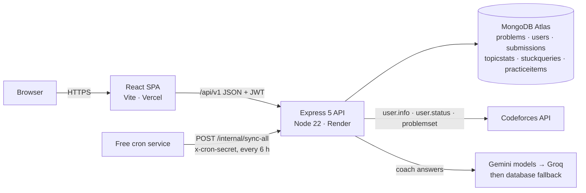

# AlgoLearn

A personal competitive-programming coach built on Codeforces data, for **practice and upsolving
only** (never for live rated contests or assessments). It:

- scores your strength in each of the 36 Codeforces topics and the 630 topic pairs (`bitmasks+dp`)
  from your own submissions;
- helps when you are stuck: paste a statement, a link, a PDF or a screenshot and get hints one at a
  time, the concept you are missing, easier similar problems, and the full solution only on request;
- recommends the next topic and problems at the right rating, and keeps a practice list.

When the AI or Codeforces fails, every screen still shows something useful (likely topics, your
weak spots, similar problems, the editorial) with a clear notice.

## Architecture

npm workspaces: `backend/` (Express, Mongoose, feature modules), `frontend/` (React 19, React
Router 7, TanStack Query, Tailwind v4, motion), `e2e/` (Playwright). Docs: `docs/API.md` (API
contract), `docs/PROGRESS.md` (log and decisions), `docs/DEPLOY.md` (deployment).

## Local setup

1. Node 22+ (`.nvmrc`) and a MongoDB Atlas cluster (or any MongoDB 7+ URI).
2. `npm install` at the root.
3. `cp backend/.env.example backend/.env` and fill it in (table below). `frontend/.env` is optional.
4. Load the problems once: get `cf_problems.parquet` (`scripts/download_dataset.py`), copy it to
   `backend/data/`, then run `npm run import:dataset` and `npm run sync:problemset`.
5. `npm run dev`: API on http://localhost:4000, app on http://localhost:5173 (Vite proxies `/api`).

## Environment variables

| Variable | Where | Notes |
|---|---|---|
| `NODE_ENV` | backend | `production` on the host (no stack traces, `trust proxy` on) |
| `PORT` | backend | 4000 locally; the host sets its own |
| `MONGODB_URI` | backend | `mongodb+srv://…` |
| `JWT_SECRET` / `JWT_EXPIRES_IN` | backend | 32+ random characters / `7d` |
| `CLIENT_URL` | backend | The frontend origin; CORS allows only this (trailing `/` is dropped) |
| `GEMINI_API_KEY` / `GEMINI_MODELS` | backend | Key from Google AI Studio; comma list, primary first |
| `GROQ_API_KEY` / `GROQ_MODEL` | backend | Optional backup provider |
| `CRON_SECRET` | backend | 16+ characters; header `x-cron-secret` for `/internal/sync-all` |
| `SYNC_CRON` / `LOG_LEVEL` | backend | Default `0 */6 * * *` / `info` |
| `VITE_API_URL` | frontend | API origin in production (e.g. `https://algolearn-api.onrender.com`); empty locally |

## Scripts (root)

| Command | What it does |
|---|---|
| `npm run dev` | API and app together |
| `npm run lint` | ESLint everywhere (max 100 lines per file) |
| `npm test` / `npm run test:cov` | Vitest unit and integration tests (backend + frontend) |
| `npm run build` | Production build of the frontend (`frontend/dist`) |
| `npm run e2e` | Playwright end-to-end tests (see below) |
| `npm run import:dataset` / `npm run sync:problemset` | Load and refresh problems |
| `npm run check:env` / `check:atlas` / `check:server` / `check:gemini` / `check:stuck` | Live checks |

## Testing

- **Unit and integration** (`npm test`): backend routes with supertest and an in-memory MongoDB;
  frontend components with Testing Library and MSW. Real Codeforces and AI are never called.
- **End-to-end** (`npm run e2e`): run `npx -w e2e playwright install chromium` once. It starts
  `e2e/server/start.js` (refuses to run without `E2E=1`): in-memory MongoDB, 24 seeded problems,
  a fake Codeforces client and a fake AI provider (text containing `AI-OUTAGE` makes it fail).
  It then builds the frontend and serves it with `vite preview`. Flows: signup → link handle →
  first sync → dashboard stats, optimistic add to practice (and rollback), stuck with text →
  hints → full solution, the AI-failure fallback, history delete with Undo, and motion (press,
  parallax, reduced motion).
- **CI** (`.github/workflows/ci.yml`): lint, unit tests and build on every push and pull request,
  then the e2e job.

## Deployment

Render (API) + Vercel (app) + MongoDB Atlas + a free cron service. Step by step: `docs/DEPLOY.md`.

## Known limitations

- Similarity is by tags and rating, so two problems with the same tags can need very different
  solutions (accepted in the brief).
- AI answers (Gemini, Groq) may be inaccurate; they are labelled as AI. Free tiers rate-limit and
  sometimes answer "high demand"; the database fallback covers that.
- Topic strength only knows what Codeforces knows: other platforms (LeetCode, CodeChef, GFG) have
  no official APIs and are not tracked.
- The dataset has gaps: about 39% of problems have no editorial, and some have no rating or tags.
- Render's free instance sleeps after 15 minutes idle: the first request takes about a minute,
  and in-process cron does not run while asleep (hence the external cron).
- Stuck requests are limited to 10 per hour per user. The layout is desktop-first; phones work
  (tables scroll sideways) but have no dedicated design.
