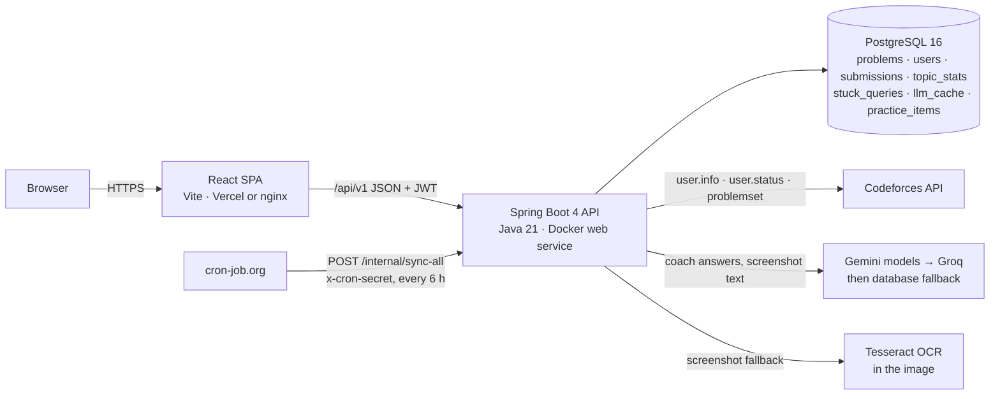
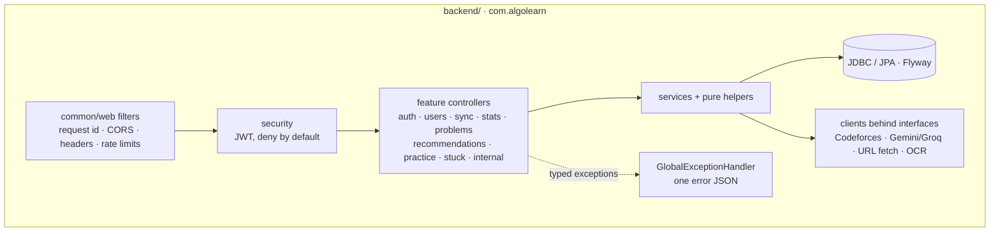

# AlgoLearn

A personal competitive-programming coach built on Codeforces data, for **practice and upsolving
only** (never for live rated contests or assessments). It:

- scores your strength in each of the 36 Codeforces topics and the 630 topic pairs (`bitmasks+dp`)
  from your own submissions;
- helps when you are stuck: paste a statement, a link, a PDF or a screenshot and get hints one at a
  time, the concept you are missing, easier similar problems, and the full solution only on request;
- recommends the next topic and problems at the right rating, and keeps a practice list.

When the AI or Codeforces fails, every screen still shows something useful (likely topics, your
weak spots, similar problems, the editorial) with a clear notice.

## Architecture

| Folder | What |
|---|---|
| `backend/` | Spring Boot 4 + PostgreSQL (Flyway, JPA/JDBC, Spring Security, Bucket4j, Tess4J, PDFBox, jsoup) — see `backend/CLAUDE.md` |
| `frontend/` | React 19, React Router 7, TanStack Query, Tailwind v4, motion — see `frontend/CLAUDE.md` |
| `e2e/` | Playwright tests against the production frontend build and the Spring `e2e` backend |
| `tools/` | `checks/` (live checks against a running backend) and `parity/` (the migration parity check) |
| `docs/` | `API.md` (frozen API contract), `PROGRESS.md` (log and decisions), `DEPLOY.md`, `PARITY.md` |

## Local setup with Docker

Needs Docker (with Compose), Java 21 and Node 22+ (`.nvmrc`).

1. `npm install` at the root.
2. `cp backend/.env.example backend/.env` and fill it in (table below). If a local PostgreSQL
   already uses port 5432, put `POSTGRES_PORT=5433` in a root `.env` and use `localhost:5433` in
   `DATABASE_URL`.
3. Load the problems once: get `cf_problems.parquet` (`python scripts/download_dataset.py`), put
   it in `backend/data/`, start the database (`npm run db:up`), then run `npm run import:dataset`
   and `npm run sync:problemset`.
4. Develop with `npm run dev`: Postgres in Docker, the API on http://localhost:4000 and the app on
   http://localhost:5173 (Vite proxies `/api`).
5. Or run everything in containers: `docker compose up --build` → http://localhost:8080 (nginx
   serves the build and proxies `/api` to the backend; the backend reads `backend/.env`, runs with
   the `prod` profile and a 512 MB memory limit).

## Environment variables (backend)

| Variable | Notes |
|---|---|
| `SPRING_PROFILES_ACTIVE` | empty locally; `prod` on the host (no stack traces, proxy headers for client IPs) |
| `PORT` | 4000 locally; the host may set its own |
| `DATABASE_URL` / `DATABASE_USERNAME` / `DATABASE_PASSWORD` | `jdbc:postgresql://host:5432/db?sslmode=require` and its credentials |
| `JWT_SECRET` / `JWT_EXPIRES_IN` | 32+ random characters / `7d` |
| `CLIENT_URL` | the frontend origin; CORS allows only this |
| `GEMINI_API_KEY` / `GEMINI_MODELS` | key from Google AI Studio; comma list, primary first |
| `GROQ_API_KEY` / `GROQ_MODEL` | optional backup provider |
| `CRON_SECRET` | 16+ characters; header `x-cron-secret` for `/internal/sync-all` |
| `SYNC_CRON` / `LOG_LEVEL` | default `0 */6 * * *` / `info` |
| `TESSDATA_PREFIX` | optional; the Docker image sets it (OCR fallback for screenshots) |

Every variable is checked at startup; a missing or invalid one stops the app with a list of all
problems. The frontend needs only `VITE_API_URL` in production (the API origin, no `/api`).

## Scripts (root)

| Command | What it does |
|---|---|
| `npm run dev` | Postgres + API + app with prefixed logs |
| `npm run db:up` / `npm run db:down` | Postgres container only |
| `npm run lint` | Checkstyle (Java) + ESLint; max 100 lines per file |
| `npm test` | backend `mvnw verify` (tests, JaCoCo coverage, Checkstyle) + frontend Vitest |
| `npm run build` | production build of the frontend (`frontend/dist`) |
| `npm run e2e` / `npm run e2e:server` | Playwright tests / the E2E backend alone (needs `E2E=1`) |
| `npm run parity` | legacy vs Spring parity check → `docs/PARITY.md` (see below) |
| `npm run import:dataset` / `npm run sync:problemset` | load and refresh problems |
| `npm run check:server` / `check:stuck` | live checks against a running backend (`CHECK_EMAIL`, `CHECK_PASSWORD`, optional `CHECK_BASE_URL`) |
| `npm run check:coach` / `check:ocr` | one real coach call / OCR inside the built backend image |

## Testing

- **Backend** (`npm test`): JUnit 5, AssertJ, Mockito; MockMvc integration tests on the real
  security chain against one shared Testcontainers PostgreSQL; WireMock for Codeforces, Gemini and
  Groq; an injected `Clock` (no real sleeps). JaCoCo gates lines 80 % / branches 75 %.
- **Frontend**: Vitest, Testing Library and MSW; never the real backend.
- **End-to-end** (`npm run e2e`; run `npx -w e2e playwright install chromium` once): Playwright
  drives the production build (`vite preview`) against the Spring backend's `e2e` profile
  (`backend/src/test/java/com/algolearn/e2e`, never in the production jar): a fresh Testcontainers
  PostgreSQL with 24 seeded problems, a fake Codeforces client (handles `e2e_*`), a fake AI
  provider (text containing `AI-OUTAGE` makes it fail) and no OCR. It refuses to start without
  `E2E=1` and warms the JVM before it reports healthy.
- **Parity**: `npm run parity` sends the same 109-request sequence to the legacy Express E2E server
  and the Spring e2e backend and compares status codes, error codes and JSON shapes (values with
  ids and timestamps masked). Without the legacy server it compares against the saved snapshot
  `tools/parity/legacy-snapshot.json`. Report: `docs/PARITY.md`.
- **CI** (`.github/workflows/ci.yml`): backend `mvnw verify`; frontend lint, tests and build;
  Playwright e2e; Docker images plus an OCR run inside the backend image.

## Deployment

Backend as a Docker web service, managed PostgreSQL (Neon or Supabase), the frontend on Vercel and
cron-job.org for the 6-hourly sync. Step by step: `docs/DEPLOY.md`.

## Known limitations

- Similarity is by tags and rating, so two problems with the same tags can need very different
  solutions (accepted in the brief).
- AI answers (Gemini, Groq) may be inaccurate; they are labelled as AI. Free tiers rate-limit and
  sometimes answer "high demand"; the database fallback covers that.
- Topic strength only knows what Codeforces knows: other platforms have no official APIs.
- The dataset has gaps: about 39 % of problems have no editorial, and some have no rating or tags.
- Free hosts sleep when idle: the first request can take a minute, and the in-process scheduler
  does not run while asleep (hence the external cron).
- Stuck requests are limited to 10 per hour per user. The layout is desktop-first.
